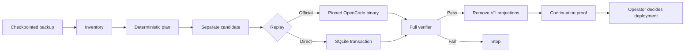

# OpenCode V1 → V2 Session Migration

[简体中文](README.md) | [English](README.en.md)

[](https://github.com/Suixinlei/opencode-v1-to-v2/actions/workflows/ci.yml)
[](LICENSE)

Safely convert persisted OpenCode V1 session history in `opencode.db` into V2
durable events and projections that can still be read, resumed, and appended to.

> [!IMPORTANT]
> This is a high-risk, offline, one-off database migration utility—not a normal
> upgrade command. Use it only with a checkpointed, quiescent backup and always
> create a separate candidate database. The project never replaces a live
> database.

## What problem does it solve?

OpenCode V1 history is represented by legacy `message` / `part` projections and
older durable events. V2 continuation relies on `session.next.*` events and new
projections such as `session_message` and `session_input`.

OpenCode's V1 migration guide covers configuration, plugins, and client
contracts, but it does not batch-convert persisted session history. Merely
upgrading the runtime does not prove that old context reached the V2 projector
or that the original session can continue.

This project provides the missing data-migration workflow:

1. inventory and classify legacy, V2, and mixed sessions;
2. build a deterministic event plan from pinned upstream semantics;
3. replay only into a separate candidate;
4. verify sequences, projections, session state, and protected sessions;
5. remove only legacy `message` / `part` projections after verification;
6. prove that old context can reach a model and write back to the same session.

## Inputs and outputs

Inputs:

- a quiescent `opencode.db` backup with its WAL checkpointed;
- an optional set of session IDs;
- a digest-pinned OpenCode image for official replay.

Outputs:

- a redacted `inventory.json`;
- a `plan.json` bound to the source, recipe, and target profile;
- a separate migrated candidate database;
- verification, cleanup, and continuation-proof receipts.

Reports contain structure, counts, booleans, and digests—not prompts, reasoning,
tool output, cookies, or conversation bodies.

## Workflow



## Safety guarantees

- Preserves the original session ID.
- Fails closed on unknown roles, parts, tool states, compaction, sequences, or
  projection differences.
- Requires source and candidate to be different files.
- Protects existing V2 data and unselected sessions.
- Invalidates stale plans when recipe, target profile, schema, or source data
  changes.
- Requires explicit `--execute` for every write command.
- Cleans legacy projections only after replay and full verification.
- Never replaces a live database.

See the [safety model](docs/safety-model.md) for the full threat model and
operator responsibilities.

## Intended use

Use this project when you must preserve and continue V1 OpenCode sessions, can
quiesce the source database, and can run a canary before a batch.

Do not use it as a generic SQLite repair tool, for live lock-free mutation, or
against an unreviewed OpenCode version. It is an independent community project
and is not affiliated with or endorsed by OpenCode or Vercel.

## Current compatibility

The current release is source-only `0.1.0`; no npm package is published.

- Target profile: `opencode-v2@1.18.9+4da7bb44.official-musl-v1`
- OpenCode: `1.18.9`
- Commit: `4da7bb44c84e013fa53e9c5d02ac753d1435c81a`
- Official musl binary SHA-256:
  - `linux/amd64`:
    `fcd56e4ea76e80b08b936cd2fb3dff18a1eaf8c871180e66e2e7424c3634c188`
  - `linux/arm64`:
    `6f08a8a1e91dfe0720d2b6eae8767c10d236c808b7147c5c1944da2862b0b0ce`
- Recipe: `opencode-v1-history-to-v2-events@6`
- Runtime: Bun `1.3.x`
- Tested platforms: macOS and Linux

Other OpenCode versions are not supported by implication. See
[compatibility](docs/compatibility.md).

## Quick start

```bash
git clone https://github.com/Suixinlei/opencode-v1-to-v2.git
cd opencode-v1-to-v2
bun install --frozen-lockfile
bun run verify
bun run migrate -- --help
```

Start with a read-only inventory:

```bash
bun run migrate -- inventory \
  --database /absolute/path/backup/opencode.db \
  --run-dir /absolute/path/run/inventory
```

For the first canary, use official replay. The public target image exists only
to run the pinned OpenCode projector and API; it contains neither this
migration utility nor any database or run artifact. Its auditable inputs are
documented under
[`docker/opencode-target`](docker/opencode-target/README.md).

Resolve the OCI manifest digest from the discovery tag:

```bash
docker buildx imagetools inspect \
  ghcr.io/suixinlei/opencode-v1-to-v2-target:1.18.9-4da7bb44
```

Then pass only the immutable digest reference:

```bash
bun run migrate -- migrate-local \
  --database /absolute/path/backup/opencode.db \
  --candidate /absolute/path/candidate/opencode.db \
  --plan /absolute/path/run/inventory/plan.json \
  --run-dir /absolute/path/run/migrate \
  --image ghcr.io/suixinlei/opencode-v1-to-v2-target@sha256:<manifest-digest> \
  --execute
```

The tool additionally checks the OpenCode version and binary SHA-256 inside the
container. `OPENCODE_MIGRATION_IMAGE` may be used instead of `--image`.

After successful replay and verification:

```bash
bun run migrate -- cleanup-local \
  --database /absolute/path/backup/opencode.db \
  --candidate /absolute/path/candidate/opencode.db \
  --plan /absolute/path/run/inventory/plan.json \
  --run-dir /absolute/path/run/cleanup \
  --execute
```

`--direct-replay` does not need Docker, but it should only be used for batch
maintenance after the target profile has passed an official-replay canary and
continuation proof.

## Commands

| Command | Purpose | Writes |
| --- | --- | --- |
| `inventory` | Classify sessions and build a redacted plan | No |
| `mixed-inventory` | Build an advanced plan for known mixed sessions | No |
| `migrate-local` | Copy/resume a candidate, replay, and verify | Candidate |
| `cleanup-local` | Remove verified legacy projections | Candidate |
| `mixed-migrate-local` | Splice events for known mixed shapes | Candidate |
| `mixed-cleanup-local` | Remove mixed-session legacy projections | Candidate |
| `prove-continuation-local` | Prove same-session continuation with a mock model | Candidate |
| `prove-continuation-live` | Organization-specific remote acceptance adapter | External |

## Documentation

- [Architecture and responsibilities](docs/architecture.md) (Chinese)
- [Compatibility](docs/compatibility.md) (Chinese)
- [Safety model](docs/safety-model.md) (Chinese)
- [Target image purpose and build](docker/opencode-target/README.md) (Chinese)
- [Fleet operations adapter](ops/README.md) (Chinese)
- [Contributing](CONTRIBUTING.md) (Chinese)
- [Security policy](SECURITY.md) (Chinese)
- [Third-party notices](THIRD_PARTY_NOTICES.md)

## License

Licensed under the [Apache License 2.0](LICENSE). Copyright and attribution
notices are recorded in [NOTICE](NOTICE) and
[THIRD_PARTY_NOTICES.md](THIRD_PARTY_NOTICES.md).
