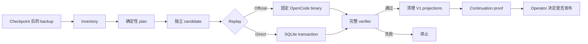

# OpenCode V1 → V2 Session Migration

[简体中文](README.md) | [English](README.en.md)

[](https://github.com/Suixinlei/opencode-v1-to-v2/actions/workflows/ci.yml)
[](LICENSE)

把已经持久化在 `opencode.db` 中的 OpenCode V1 会话历史，安全转换为 V2 可以
继续读取、继续写入和继续对话的 durable events 与 projections。

> [!IMPORTANT]
> 这是高风险、离线、一次性的数据库迁移工具，不是普通升级命令。它只应处理
> checkpoint 后的一致性 backup，并始终先生成独立 candidate。项目不会自动
> 替换 live database。

## 这个项目解决什么问题

OpenCode 的 V1 会话历史主要体现在 `message` / `part` 投影和旧 durable events
中；V2 的运行与续聊依赖 `session.next.*` events，以及
`session_message`、`session_input` 等新投影。

OpenCode 的 V1 → V2 升级指引覆盖配置、插件和客户端契约，但不会把已有
`opencode.db` 里的 session history 批量转换成 V2 结构。直接升级运行时可能
保留旧行，却不能证明旧上下文已经进入 V2 projector，也不能证明原 session
还能继续对话。

这个项目补的是这段数据迁移链路：

1. 盘点数据库并区分纯 V1、纯 V2 和 mixed session；
2. 按固定上游语义生成确定性的 V2 event plan；
3. 只在独立 candidate 上 replay；
4. 校验 event sequence、V2 projections、session 状态和未选择数据；
5. 验证通过后只清理 V1 `message` / `part` 投影；
6. 证明旧上下文能够进入模型，并在同一个 session 中继续写入。

## 它的输入和输出

输入：

- 一个已停止写入、完成 WAL checkpoint 的 `opencode.db` backup；
- 可选的 session ID 范围；
- 需要 official replay 时，一个 digest-pinned OpenCode image。

输出：

- 脱敏的 `inventory.json`；
- 与 source、recipe、target profile 绑定的 `plan.json`；
- 独立的 migrated candidate database；
- verification、cleanup 和 continuation proof receipts。

输出报告只保存结构、计数、布尔结果和摘要，不保存 prompt、reasoning、
tool output、Cookie 或会话正文。

## 工作流



## 核心安全保证

- **保留 session ID**：不会创建替代 session 来伪装迁移成功。
- **Fail closed**：未知 role、part、tool state、compaction、sequence 或投影
  差异会阻断，不会静默跳过。
- **不碰 live DB**：source 和 candidate 必须是不同文件。
- **保护现有 V2 数据**：不能只因仍有 `message/part` 就把 session 当成纯 V1。
- **保护未选择 session**：迁移前后会比较其语义摘要。
- **Plan 可失效**：recipe、target profile、schema 或 source 内容变化都会拒绝
  旧 plan。
- **显式写授权**：所有写命令都要求 `--execute`。
- **先验证后清理**：cleanup 不能绕过 replay 和完整 verifier。

更完整的威胁和操作模型见 [安全模型](docs/safety-model.md)。

## 适合与不适合

| 适合 | 不适合 |
| --- | --- |
| 需要保留并续聊 OpenCode V1 历史 | 只迁移配置、插件或客户端设置 |
| 可以先停写、checkpoint、制作 backup | 必须在线无锁修改正在写入的数据库 |
| 愿意先做单 session canary | 想对未知 OpenCode 版本直接批量执行 |
| 需要可审计 plan、verification 和 rollback 证据 | 没有 backup 或不能承担回滚流程 |

它不是通用 SQLite 修复器，也不是 OpenCode 官方项目。项目与 OpenCode、Vercel
没有隶属或背书关系。

## 当前支持范围

当前版本是源码形式的 `0.1.0`，尚不发布 npm package。

- Target profile：`opencode-v2@1.18.9+4da7bb44.official-musl-v1`
- OpenCode：`1.18.9`
- OpenCode commit：`4da7bb44c84e013fa53e9c5d02ac753d1435c81a`
- OpenCode 官方 musl binary SHA-256：
  - `linux/amd64`：
    `fcd56e4ea76e80b08b936cd2fb3dff18a1eaf8c871180e66e2e7424c3634c188`
  - `linux/arm64`：
    `6f08a8a1e91dfe0720d2b6eae8767c10d236c808b7147c5c1944da2862b0b0ce`
- Migration recipe：`opencode-v1-history-to-v2-events@6`
- Runtime：Bun `1.3.x`
- 已验证平台：macOS、Linux

项目不承诺其他 OpenCode 版本可以使用。完整范围见
[兼容性说明](docs/compatibility.md)。

## 快速开始

### 1. 安装并验证

```bash
git clone https://github.com/Suixinlei/opencode-v1-to-v2.git
cd opencode-v1-to-v2
bun install --frozen-lockfile
bun run verify
bun run migrate -- --help
```

### 2. 只读盘点

先停止 source database 的写入并完成 WAL checkpoint。不要把 live DB 当作后续
candidate。

```bash
bun run migrate -- inventory \
  --database /absolute/path/backup/opencode.db \
  --run-dir /absolute/path/run/inventory
```

该步骤只读，生成 `inventory.json` 和 `plan.json`。如果 plan 中存在 blocking
diagnostic，应停止并调查，不要手工修改 plan。

### 3. 生成并验证 candidate

首次 canary 推荐使用 official replay。公开 target image 的唯一作用是运行固定的
OpenCode projector/API；迁移工具、数据库和 run 产物都不会打进镜像。镜像定义
和全部 checksum 见
[`docker/opencode-target`](docker/opencode-target/README.md)。

先从版本 tag 查询 OCI manifest digest：

```bash
docker buildx imagetools inspect \
  ghcr.io/suixinlei/opencode-v1-to-v2-target:1.18.9-4da7bb44
```

然后只把不可变 digest 引用交给迁移命令：

```bash
bun run migrate -- migrate-local \
  --database /absolute/path/backup/opencode.db \
  --candidate /absolute/path/candidate/opencode.db \
  --plan /absolute/path/run/inventory/plan.json \
  --run-dir /absolute/path/run/migrate \
  --image ghcr.io/suixinlei/opencode-v1-to-v2-target@sha256:<manifest-digest> \
  --execute
```

工具会继续校验容器内 OpenCode version 和 binary SHA-256。也可以通过
`OPENCODE_MIGRATION_IMAGE` 环境变量提供同一镜像。

只有在该 target profile 已完成 official replay canary 后，批量维护才应考虑
`--direct-replay`：

```bash
bun run migrate -- migrate-local \
  --database /absolute/path/backup/opencode.db \
  --candidate /absolute/path/candidate/opencode.db \
  --plan /absolute/path/run/inventory/plan.json \
  --run-dir /absolute/path/run/migrate \
  --direct-replay \
  --execute
```

### 4. 清理 legacy projection

```bash
bun run migrate -- cleanup-local \
  --database /absolute/path/backup/opencode.db \
  --candidate /absolute/path/candidate/opencode.db \
  --plan /absolute/path/run/inventory/plan.json \
  --run-dir /absolute/path/run/cleanup \
  --execute
```

cleanup 只删除已迁移 session 的旧 `message` / `part` 投影。V1 durable event
前缀、V2 message/input/context 和续聊后缀会保留。

## 命令

| 命令 | 作用 | 是否写入 |
| --- | --- | --- |
| `inventory` | 分类 session、生成脱敏 inventory 和普通 plan | 否 |
| `mixed-inventory` | 为已知 mixed session 生成高级 plan | 否 |
| `migrate-local` | 复制/续跑 candidate，replay 并完整验证 | 是，candidate |
| `cleanup-local` | 验证后清理普通 V1 projections | 是，candidate |
| `mixed-migrate-local` | 对已知 mixed 形态执行 event splice 或已覆盖双写清理 | 是，candidate |
| `mixed-cleanup-local` | 清理 mixed session 的 legacy projections | 是，candidate |
| `prove-continuation-local` | 用 mock model 证明同 session 续聊和重启读取 | 是，candidate |
| `prove-continuation-live` | 组织运行环境的远端验收 adapter | 外部环境 |

Mixed migration 和 continuation proof 的约束见
[兼容性说明](docs/compatibility.md)与[架构说明](docs/architecture.md)。

## Run 产物

```text
run/<run-id>/
├── inventory/
│   ├── inventory.json
│   └── plan.json
├── migrate/
│   ├── receipt.json
│   ├── verification.json
│   └── official-replay.json | direct-replay.json
├── cleanup/
│   ├── cleanup-receipt.json
│   └── cleanup-verification.json
└── continuation/
    └── continuation-proof.json
```

run 目录使用 `0700`，JSON 使用 `0600`。backup 和 candidate 包含真实会话内容，
即使报告已脱敏，也不要把任何 run 产物提交到 Git。

## 设计依据

- [OpenCode：Migrate from V1](https://opencode.ai/v2/docs/migrate-v1)
- [固定 commit 的 V1 history lowering](https://github.com/anomalyco/opencode/blob/4da7bb44c84e013fa53e9c5d02ac753d1435c81a/packages/opencode/src/session/message-v2.ts)
- [固定 commit 的 V2 projector](https://github.com/anomalyco/opencode/blob/4da7bb44c84e013fa53e9c5d02ac753d1435c81a/packages/core/src/session/message-updater.ts)
- [AI SDK 6.0.168 的 step-start block flush](https://github.com/vercel/ai/blob/ai%406.0.168/packages/ai/src/ui/convert-to-model-messages.ts)

上游版权与许可证见 [THIRD_PARTY_NOTICES.md](THIRD_PARTY_NOTICES.md)。

## 文档

- [架构与职责](docs/architecture.md)
- [兼容性](docs/compatibility.md)
- [安全模型](docs/safety-model.md)
- [Target image 的作用与构建](docker/opencode-target/README.md)
- [Fleet operations adapter](ops/README.md)
- [开源就绪度](docs/open-source-readiness.md)
- [GitHub 仓库设置与首次推送](docs/repository-settings.md)
- [贡献指南](CONTRIBUTING.md)
- [安全策略](SECURITY.md)
- [Changelog](CHANGELOG.md)

## License

Licensed under the [Apache License 2.0](LICENSE). Copyright and attribution
notices are recorded in [NOTICE](NOTICE) and
[THIRD_PARTY_NOTICES.md](THIRD_PARTY_NOTICES.md).
