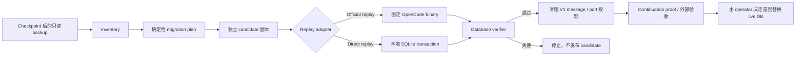

# 架构与职责

## 设计目标

这个项目的核心不是“改几张 SQLite 表”，而是提供一个深迁移模块：

- 调用者只需要理解一致性 backup、session 选择、target profile 和 candidate；
- 模块内部负责识别 V1 语义、生成确定性事件、维护 sequence、构建 V2 投影、
  校验完整数据库并产生脱敏证据；
- 未知形态不会穿透接口成为隐式数据损失，而是统一 fail closed。

CLI 是当前对外接口。TypeScript 导出主要服务于项目内部测试，不承诺稳定的库
接口。

## 数据流



项目不会执行图中最后一步。live database 的替换、租约、停写和回滚属于部署
环境自己的运维模块。

## 模块

| 模块 | 接口 | 隐藏的实现复杂度 |
| --- | --- | --- |
| Source inspection | `inventoryDatabase`、只读 snapshot | SQLite immutable 读取、schema fingerprint、WAL 检查、session 分类、脱敏统计 |
| Planner / recipe | `buildMigrationPlan` | V1 history lowering、确定性 ID、event sequence、诊断、受保护 session 摘要 |
| Migration executor | `migrateLocal` | candidate 复制、中断续跑、replay 选择、receipt 和文件权限 |
| Replay adapters | official replay / direct replay | Docker OpenCode 身份校验，或单事务投影写入 |
| Target runtime | `docker/opencode-target` | 上游资产 checksum、平台 binary identity、最小容器依赖、GHCR provenance |
| Verifier / cleanup | `verifyMigration`、`cleanupLocal` | 语义摘要、完整性校验、幂等清理、续聊后缀保护 |
| Continuation proof | `proveContinuationLocal` | mock model、同 session 写回、重启后读取、脱敏 proof |
| Mixed migration | `buildMixedMigrationPlan` 等 | 已有 V2 前后缀识别、sequence splice、历史投影兼容 |

## 真实 seam

### Replay seam

Replay 已经有两个 adapter，因此这是一个真实 seam：

- **Official replay adapter**：让固定 OpenCode binary 自己执行 `/sync/replay`，
  用于证明投影与上游行为一致。
- **Direct replay adapter**：在一个 SQLite transaction 中物化 plan 已确定的
  event、message 和 input，用于已完成 canary 的批量维护。

两者共享同一 plan 和 verifier。调用者不会因为选择 adapter 而学习两套迁移
语义。

### 外部运行环境 seam

本地 continuation proof 可以公开复现；远端 Runtime/controller、Cookie、租约、
SSH/SCP 和固定存储布局属于组织适配。它们不应进入公共迁移核心的接口。

当前 `ops/` 与 `src/live-continuation-proof.ts` 作为参考 integration 保留，但
所有环境端点和主机都必须显式传入；它们不是公共迁移接口，也没有通用生产兼容
承诺。

本地 continuation proof 把两个运行职责分开：target image 只运行固定 OpenCode，
digest-pinned Bun helper image 只运行匿名 mock model。两者都不包含真实数据库、
凭证或会话正文。

## 没有引入的 seam

- 当前只支持 SQLite，不为尚不存在的第二种存储实现抽象 repository。
- target profile 是固定兼容性契约，不设计任意版本插件系统。
- report writer 只有安全本地文件这一种实现，保持为内部实现。

这样可以避免为了“看起来可扩展”增加浅接口，同时把测试集中在真正的迁移接口
和可观察结果上。

## 核心不变量

1. source backup 和 candidate 必须是不同文件。
2. plan 绑定 recipe、target profile、source schema 和 source content digest。
3. 未选择的 session 必须保持语义摘要不变。
4. 已有 V2 state、未知 discriminator 或投影偏差默认阻断。
5. 写操作必须显式传入 `--execute`。
6. cleanup 只能发生在 replay 和完整 verifier 通过之后。
7. 工具永远不自动替换 live database。
8. 报告只保存结构、计数、布尔值和摘要，不保存会话正文或凭证。

## 目录职责

```text
src/
  cli.ts                     CLI 接口
  inventory.ts               只读盘点
  planner.ts                 确定性 plan
  recipe-v1-to-v2.ts         V1 → V2 lowering 语义
  open-code-replay.ts        official replay adapter
  direct-replay.ts           direct replay adapter
  verifier.ts                完整性和语义验证
  cleanup.ts                 legacy projection 清理
  continuation-proof.ts      可本地复现的续聊证明
  mixed-migration.ts         高级 mixed session 迁移
  live-continuation-proof.ts 组织适配，待隔离
ops/                         显式配置的参考 fleet adapter
docker/opencode-target/      可审计的 official replay runtime
scripts/                     匿名 target image 端到端验收
tests/                       人工 fixture 与接口级回归测试
```
